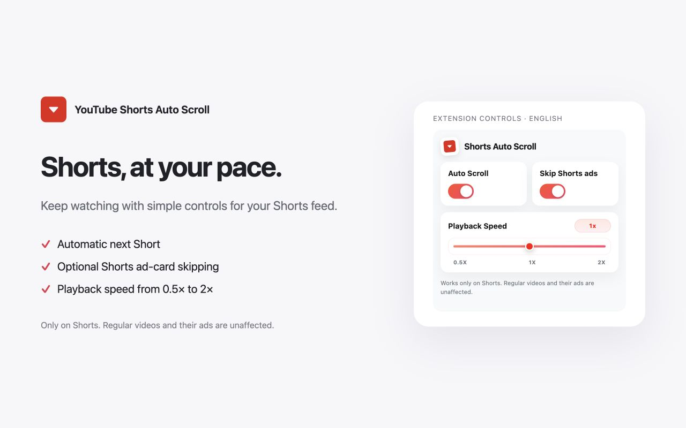

#  YouTube Shorts Auto Scroll

A Chrome extension that moves to the next YouTube Short when the current one ends, with optional Shorts feed-ad skipping and playback speed controls.



## Features

- Automatically advance when the active Short finishes.
- Set Shorts playback speed to 0.5×, 0.75×, 1×, 1.5×, or 2×.
- Optionally scroll past detected sponsored cards in the Shorts feed.
- Control auto-scroll and sponsored-card skipping separately.
- Use the popup in English, Traditional Chinese, or Simplified Chinese.
- Keep preferences with Chrome's built-in settings sync.

Version 1.4.0 confines these actions to the active Shorts card. Regular YouTube videos are outside the feature scope. The extension does not intercept network requests or fast-forward, mute, or seek through video ads. Sponsored-card skipping depends on YouTube's page structure; it is not guaranteed to remove every ad or prevent YouTube playback warnings.

## Install

### Chrome/Edge

1. Open the [Chrome Web Store listing](https://chromewebstore.google.com/detail/youtube-shorts-auto-scrol/ejiondkplaoolmmnepmpipdpaeibfjen).
2. Click "Add extension"
3. Enjoy your YouTube shorts video

## Development

Use Node.js 22 or 24 and the system `zip` / `unzip` tools. There is no bundler or background service worker.

```bash
npm ci                # Install locked dependencies
npm run lint          # JavaScript correctness checks
npm test              # Run all tests
npm run test:watch    # Watch mode
npm run test:coverage # Coverage report and thresholds
npm run validate     # Check versions, assets, and translations
npm run build        # Build and verify the store upload ZIP
```

For local testing, load the repository folder with **Load unpacked** at `chrome://extensions`, then reload existing YouTube tabs.

The content script is registered for YouTube pages so it can recognize YouTube's navigation into Shorts without a full reload. It checks the current route before acting and stops Shorts processing when you leave the Shorts page.

## Publishing

CI runs lint, coverage tests, and packaging on Node.js 22 and 24. Pushing a version tag such as `v1.4.0` runs the same checks and publishes `youtube-shorts-auto-scroll.zip` as a GitHub release asset. Chrome Web Store submission is a separate step; a GitHub release does not publish a store update.

See the [submission checklist](store/submission.md), [English listing](store/listing-en.md), [繁體中文 listing](store/listing-zh-TW.md), and [简体中文 listing](store/listing-zh-CN.md).

## Privacy and support

The extension has no analytics, publisher server, or external telemetry. Preferences are stored through `chrome.storage.sync`; Chrome may synchronize them through the user's Google account when browser sync is enabled. See the [privacy policy](docs/privacy-policy.md).

Report issues through [GitHub Issues](https://github.com/ycchuang99/youtube-shorts-auto-scroll/issues). This extension is independent of YouTube and Google.
